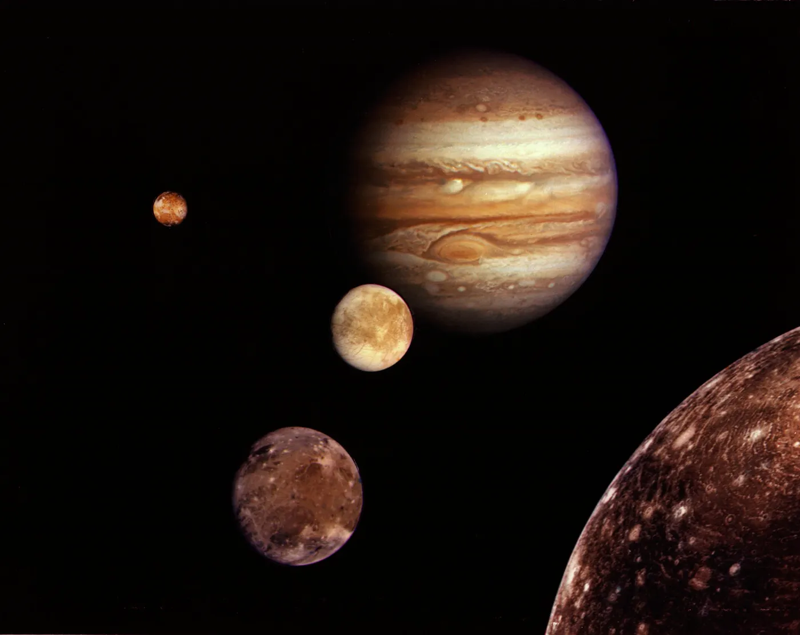
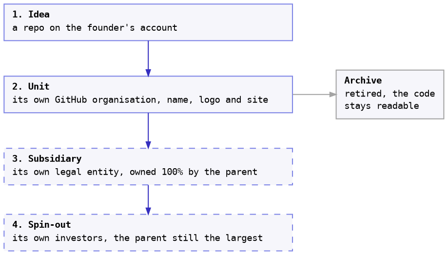

# Structure

> **Working draft.** This is how Planet Renox is organised today and where we want to take it. None of it is a legal filing yet. We update this page as things become official. Last updated November 20, 2026.

## The idea

We like software, and we think a company should be built the way good software is: out of small services that each do one job, sit behind a clear interface, and can be shipped, scaled or switched off without breaking the rest.

So Planet Renox is not one big company with departments. It is a **parent** with small **units** around it. A unit makes one thing. It has its own name, logo, code and site, and it would keep working if every other unit vanished.

A pile of unrelated companies could do that too. Putting them under one parent adds two things:

- **Deep collaboration.** A unit can use anything another unit has made, whether code, fonts, servers or people, without a negotiation, because nobody owns a piece of one unit and not of the others.
- **Choice of money flow.** Money earned in one place can be spent in any other. The parent decides where it does the most good.


*One planet, many moons, each a world of its own. Jupiter and its four largest moons, Voyager 1, 1979. NASA/JPL, public domain.*

## Who is who

Today a unit is a GitHub organisation: that is where one service ends and the next begins. There are fifteen, plus the account where new ideas start.

```dot
graph "Planet Renox and its units" {
  layout=twopi; root=parent; ranksep=2.75; bgcolor=transparent
  node [shape=none fontname=Courier fontsize=9 fixedsize=true width=1.3 height=0.9 imagepos=tc labelloc=b target="_blank"]
  edge [color="#7f86e6" style=dotted penwidth=1.6]

  parent [label="" image="/orgs/PlanetRenox.svg" imagescale=true width=1.6 height=1.6 URL="https://github.com/PlanetRenox"]

  "sune-org" [image="/orgs/sune-org.webp" URL="https://github.com/sune-org"]
  "lynchmarkHQ" [image="/orgs/lynchmarkHQ.webp" URL="https://github.com/lynchmarkHQ"]
  "direct-img" [image="/orgs/direct-img.webp" URL="https://github.com/direct-img"]
  "ApopheniaNews" [image="/orgs/ApopheniaNews.webp" URL="https://github.com/ApopheniaNews"]
  "ApopheniaLoop" [image="/orgs/ApopheniaLoop.webp" URL="https://github.com/ApopheniaLoop"]
  "inzerosight" [image="/orgs/inzerosight.webp" URL="https://github.com/inzerosight"]
  "GetOpenScript" [image="/orgs/GetOpenScript.webp" URL="https://github.com/GetOpenScript"]
  "EverythingPublic" [image="/orgs/EverythingPublic.webp" URL="https://github.com/EverythingPublic"]
  "hi-language" [image="/orgs/hi-language.webp" URL="https://github.com/hi-language"]
  "OctopusSuite" [image="/orgs/OctopusSuite.webp" URL="https://github.com/OctopusSuite"]
  "deployflare" [image="/orgs/deployflare.webp" URL="https://github.com/deployflare"]
  "microcron" [image="/orgs/microcron.webp" URL="https://github.com/microcron"]
  "archive-yard" [image="/orgs/archive-yard.webp" URL="https://github.com/archive-yard"]
  "4ev-link" [image="/orgs/4ev-link.webp" URL="https://github.com/4ev-link"]
  "multipleof4" [image="/orgs/multipleof4.webp" URL="https://github.com/multipleof4"]

  // product units
  parent -- { "sune-org" "lynchmarkHQ" "direct-img" "ApopheniaNews" "ApopheniaLoop" "inzerosight" "GetOpenScript" "EverythingPublic" "hi-language" "OctopusSuite" }
  // platform units, retired units and the incubator
  parent -- { "deployflare" "microcron" "archive-yard" "4ev-link" "multipleof4" } [color="#a4a4a4"]
}
```

- **The parent**, `PlanetRenox`, in the middle. It holds what every unit shares: the name, the logo, the domain, the typefaces, the clock.
- **Ten product units** make the things people use: `sune-org`, `lynchmarkHQ`, `direct-img`, `ApopheniaNews`, `ApopheniaLoop`, `inzerosight`, `GetOpenScript`, `EverythingPublic`, `hi-language` and `OctopusSuite`.
- **Two platform units** run things for the others: `deployflare` and `microcron`.
- **Two retired units**: `4ev-link`, which we shut down, and `archive-yard`, where finished experiments rest.
- **The incubator**, `multipleof4`, is the founder's own account. Things start there before they earn an organisation of their own.

## What flows between them

Units are separate, not sealed off. Every arrow below is something one unit made that another one uses today.

```dot
digraph "What flows between units" {
  rankdir=LR; bgcolor=transparent; nodesep=0.13; ranksep=2.3
  fontname=Courier; fontsize=9; labeljust=l; color="#a4a4a4"; style=dotted
  node [shape=box fontname=Courier fontsize=9 style=filled fillcolor="#f6f6fb" color="#7f86e6" margin="0.1,0.05" width=2.1 height=0.32]
  edge [arrowsize=0.6]

  subgraph cluster_parent { label=<<TABLE BORDER="0" CELLSPACING="0" CELLPADDING="2"><TR><TD FIXEDSIZE="TRUE" WIDTH="22" HEIGHT="22"></TD><TD><B>PlanetRenox</B> makes</TD></TR></TABLE>>
    web [label="planetrenox.com subdomains"]
    stain [label="Stain typeface"]
    mono [label="Monostain typeface"]
    c [label="c, the visit counter"]
    news [label="newsletter backend"]
  }
  subgraph cluster_sune { label=<<TABLE BORDER="0" CELLSPACING="0" CELLPADDING="2"><TR><TD FIXEDSIZE="TRUE" WIDTH="22" HEIGHT="22"></TD><TD><B>sune-org</B> makes</TD></TR></TABLE>>
    latex [label="markdown-it-latex-plus"]
  }
  subgraph cluster_direct { label=<<TABLE BORDER="0" CELLSPACING="0" CELLPADDING="2"><TR><TD FIXEDSIZE="TRUE" WIDTH="22" HEIGHT="22"></TD><TD><B>direct-img</B> makes</TD></TR></TABLE>>
    img [label="pictures and animations"]
    stars [label="star history charts"]
  }
  subgraph cluster_m4 { label=<<TABLE BORDER="0" CELLSPACING="0" CELLPADDING="2"><TR><TD FIXEDSIZE="TRUE" WIDTH="22" HEIGHT="22"></TD><TD><B>multipleof4</B> makes</TD></TR></TABLE>>
    ripple [label="tiny-ripple"]
  }

  subgraph cluster_users { label="and these use it"
    node [shape=none style="" margin=0 width=0 height=0]
    sune [label=<<TABLE BORDER="0" CELLSPACING="0" CELLPADDING="3"><TR><TD FIXEDSIZE="TRUE" WIDTH="30" HEIGHT="30"></TD><TD ALIGN="LEFT" BALIGN="LEFT"><B>sune-org</B><BR/>Sune chat app</TD></TR></TABLE>>]
    lynch [label=<<TABLE BORDER="0" CELLSPACING="0" CELLPADDING="3"><TR><TD FIXEDSIZE="TRUE" WIDTH="30" HEIGHT="30"></TD><TD ALIGN="LEFT" BALIGN="LEFT"><B>lynchmarkHQ</B><BR/>LLM benchmark</TD></TR></TABLE>>]
    direct [label=<<TABLE BORDER="0" CELLSPACING="0" CELLPADDING="3"><TR><TD FIXEDSIZE="TRUE" WIDTH="30" HEIGHT="30"></TD><TD ALIGN="LEFT" BALIGN="LEFT"><B>direct-img</B><BR/>images by URL</TD></TR></TABLE>>]
    apo [label=<<TABLE BORDER="0" CELLSPACING="0" CELLPADDING="3"><TR><TD FIXEDSIZE="TRUE" WIDTH="30" HEIGHT="30"></TD><TD ALIGN="LEFT" BALIGN="LEFT"><B>ApopheniaNews</B><BR/>news outlet</TD></TR></TABLE>>]
    site [label=<<TABLE BORDER="0" CELLSPACING="0" CELLPADDING="3"><TR><TD FIXEDSIZE="TRUE" WIDTH="30" HEIGHT="30"></TD><TD ALIGN="LEFT" BALIGN="LEFT"><B>PlanetRenox</B><BR/>this site</TD></TR></TABLE>>]
    m4 [label=<<TABLE BORDER="0" CELLSPACING="0" CELLPADDING="3"><TR><TD FIXEDSIZE="TRUE" WIDTH="30" HEIGHT="30"></TD><TD ALIGN="LEFT" BALIGN="LEFT"><B>multipleof4</B><BR/>incubator</TD></TR></TABLE>>]
    ev4 [label=<<TABLE BORDER="0" CELLSPACING="0" CELLPADDING="3"><TR><TD FIXEDSIZE="TRUE" WIDTH="30" HEIGHT="30"></TD><TD ALIGN="LEFT" BALIGN="LEFT"><B>4ev-link</B><BR/>retired</TD></TR></TABLE>>]
  }

  edge [color="#352fc0"]
  web -> { sune lynch }
  stain -> { lynch direct }
  mono -> { site apo m4 }
  c -> { site lynch ev4 }
  news -> { apo lynch direct }
  edge [color="#000000"]
  latex -> { sune apo site }
  edge [color="#7f86e6"]
  img -> { apo m4 }
  stars -> { sune ev4 }
  edge [color="#a4a4a4"]
  ripple -> sune
}
```

- **The domain.** Sune lives at sune.planetrenox.com and Lynchmark at lynchmark.planetrenox.com. The parent owns the address, the unit owns what is served there.
- **Typefaces.** [Stain](https://stainfont.pages.dev/) sets Lynchmark and vibegif. [Monostain](https://monostain.pages.dev/) sets this site, the code in apophenia.news and the SpeckHashX site.
- **One visit counter**, c, counts for this site and Lynchmark, as it did for 4ev.link.
- **One newsletter backend** runs the newsletters of apophenia.news, Lynchmark, direct-img.link and vibegif.
- **[markdown-it-latex-plus](https://markdown-it-latex-plus.pages.dev)**, written for Sune, also renders apophenia.news and the page you are reading.
- **direct-img** serves the pictures and animations in apophenia.news, the star charts in the Sune and 4ev.link READMEs, and the octopus on the SpeckHashX site.
- **tiny-ripple**, a small package from the incubator, makes the touch ripple in Sune.

The other nine units have no arrows yet, and that is fine. A unit is not better for being connected, only for being useful.

## Everything, unit by unit

The public projects of every unit. Each card opens that unit on GitHub.

```dot
digraph "Everything, unit by unit" {
  bgcolor=transparent; ranksep=0.2
  fontname="Courier-Bold"; fontsize=10; labeljust=l; color="#a4a4a4"; style=dotted
  node [shape=none fontname=Courier fontsize=9 fontcolor="#666666" margin=0 target="_blank"]
  edge [style=invis]

  subgraph cluster_parent { label="THE PARENT"
    parent [URL="https://github.com/PlanetRenox" label=<<TABLE BORDER="1" COLOR="#352fc0" CELLBORDER="0" CELLSPACING="0" CELLPADDING="6"><TR>
      <TD VALIGN="TOP" FIXEDSIZE="TRUE" WIDTH="36" HEIGHT="36"></TD>
      <TD><TABLE BORDER="0" CELLSPACING="0" CELLPADDING="2" WIDTH="330">
        <TR><TD ALIGN="LEFT"><FONT COLOR="#000000"><B>PlanetRenox</B></FONT></TD></TR>
        <TR><TD ALIGN="LEFT" HEIGHT="20" VALIGN="TOP"><FONT COLOR="#000000">what every unit shares</FONT></TD></TR>
        <TR><TD ALIGN="LEFT"><B>planetrenox.com</B> the home site, and this page</TD></TR>
        <TR><TD ALIGN="LEFT"><B>logo</B> the logo, written as code</TD></TR>
        <TR><TD ALIGN="LEFT"><B>StainFont</B> Stain, a typeface drawn by a program</TD></TR>
        <TR><TD ALIGN="LEFT"><B>MonostainFont</B> Monostain, its monospace sibling</TD></TR>
        <TR><TD ALIGN="LEFT"><B>ortus</B> Planet Renox Time (PRT), on npm</TD></TR>
        <TR><TD ALIGN="LEFT"><B>time.planetrenox.com</B> the live PRT clock and its API</TD></TR>
        <TR><TD ALIGN="LEFT"><B>City Zoomer</B> a game on Steam, 2021</TD></TR>
        <TR><TD ALIGN="LEFT"><B>c, newsletter</B> the visit counter and sign-up backend</TD></TR>
      </TABLE></TD></TR></TABLE>>]
  }
  subgraph cluster_ai { label="AI"
    sune [URL="https://github.com/sune-org" label=<<TABLE BORDER="1" COLOR="#7f86e6" CELLBORDER="0" CELLSPACING="0" CELLPADDING="6"><TR>
      <TD VALIGN="TOP" FIXEDSIZE="TRUE" WIDTH="36" HEIGHT="36"></TD>
      <TD><TABLE BORDER="0" CELLSPACING="0" CELLPADDING="2" WIDTH="330">
        <TR><TD ALIGN="LEFT"><FONT COLOR="#000000"><B>sune-org</B></FONT></TD></TR>
        <TR><TD ALIGN="LEFT" HEIGHT="20" VALIGN="TOP"><FONT COLOR="#000000">Sune, one chat app for every AI model</FONT></TD></TR>
        <TR><TD ALIGN="LEFT"><B>sune</B> the app, on the web and on Android</TD></TR>
        <TR><TD ALIGN="LEFT"><B>store</B> the official store of sunes</TD></TR>
        <TR><TD ALIGN="LEFT"><B>markdown-it-latex-plus</B> LaTeX and figures in Markdown</TD></TR>
        <TR><TD ALIGN="LEFT"><B>ORP, D1P, chatroom, us.proxy.sune.planetrenox.com</B> backends</TD></TR>
        <TR><TD ALIGN="LEFT"><B>StoreTemplate</B> a template for a store of your own</TD></TR>
      </TABLE></TD></TR></TABLE>>]
    lynch [URL="https://github.com/lynchmarkHQ" label=<<TABLE BORDER="1" COLOR="#7f86e6" CELLBORDER="0" CELLSPACING="0" CELLPADDING="6"><TR>
      <TD VALIGN="TOP" FIXEDSIZE="TRUE" WIDTH="36" HEIGHT="36"></TD>
      <TD><TABLE BORDER="0" CELLSPACING="0" CELLPADDING="2" WIDTH="330">
        <TR><TD ALIGN="LEFT"><FONT COLOR="#000000"><B>lynchmarkHQ</B></FONT></TD></TR>
        <TR><TD ALIGN="LEFT" HEIGHT="20" VALIGN="TOP"><FONT COLOR="#000000">Lynchmark, a benchmark for language models</FONT></TD></TR>
        <TR><TD ALIGN="LEFT"><B>lynchmark</B> the tests, the results and the site</TD></TR>
      </TABLE></TD></TR></TABLE>>]
  }
  subgraph cluster_media { label="MEDIA"
    direct [URL="https://github.com/direct-img" label=<<TABLE BORDER="1" COLOR="#7f86e6" CELLBORDER="0" CELLSPACING="0" CELLPADDING="6"><TR>
      <TD VALIGN="TOP" FIXEDSIZE="TRUE" WIDTH="36" HEIGHT="36"></TD>
      <TD><TABLE BORDER="0" CELLSPACING="0" CELLPADDING="2" WIDTH="330">
        <TR><TD ALIGN="LEFT"><FONT COLOR="#000000"><B>direct-img</B></FONT></TD></TR>
        <TR><TD ALIGN="LEFT" HEIGHT="20" VALIGN="TOP"><FONT COLOR="#000000">an image for any words, straight from a URL</FONT></TD></TR>
        <TR><TD ALIGN="LEFT"><B>direct-img.link</B> an image search in one URL</TD></TR>
        <TR><TD ALIGN="LEFT"><B>vibegif.direct-img.link</B> public domain animations</TD></TR>
        <TR><TD ALIGN="LEFT"><B>starry.direct-img.link</B> GitHub star history charts</TD></TR>
        <TR><TD ALIGN="LEFT"><B>AuroraIMG-6M, AuroraIMG2-50M</B> image models on a CPU</TD></TR>
        <TR><TD ALIGN="LEFT"><B>vibegif.lol</B> AI-made GIFs, the earlier vibegif</TD></TR>
      </TABLE></TD></TR></TABLE>>]
    apo [URL="https://github.com/ApopheniaNews" label=<<TABLE BORDER="1" COLOR="#7f86e6" CELLBORDER="0" CELLSPACING="0" CELLPADDING="6"><TR>
      <TD VALIGN="TOP" FIXEDSIZE="TRUE" WIDTH="36" HEIGHT="36"></TD>
      <TD><TABLE BORDER="0" CELLSPACING="0" CELLPADDING="2" WIDTH="330">
        <TR><TD ALIGN="LEFT"><FONT COLOR="#000000"><B>ApopheniaNews</B></FONT></TD></TR>
        <TR><TD ALIGN="LEFT" HEIGHT="20" VALIGN="TOP"><FONT COLOR="#000000">the news outlet for pattern seekers</FONT></TD></TR>
        <TR><TD ALIGN="LEFT"><B>apophenia.news</B> the site and its newsletter</TD></TR>
        <TR><TD ALIGN="LEFT"><B>merch</B> every merch design, as code</TD></TR>
      </TABLE></TD></TR></TABLE>>]
    loop [URL="https://github.com/ApopheniaLoop" label=<<TABLE BORDER="1" COLOR="#7f86e6" CELLBORDER="0" CELLSPACING="0" CELLPADDING="6"><TR>
      <TD VALIGN="TOP" FIXEDSIZE="TRUE" WIDTH="36" HEIGHT="36"></TD>
      <TD><TABLE BORDER="0" CELLSPACING="0" CELLPADDING="2" WIDTH="330">
        <TR><TD ALIGN="LEFT"><FONT COLOR="#000000"><B>ApopheniaLoop</B></FONT></TD></TR>
        <TR><TD ALIGN="LEFT"><FONT COLOR="#000000">a video channel on YouTube</FONT></TD></TR>
      </TABLE></TD></TR></TABLE>>]
  }
  subgraph cluster_browser { label="PRIVACY AND THE BROWSER"
    zero [URL="https://github.com/inzerosight" label=<<TABLE BORDER="1" COLOR="#7f86e6" CELLBORDER="0" CELLSPACING="0" CELLPADDING="6"><TR>
      <TD VALIGN="TOP" FIXEDSIZE="TRUE" WIDTH="36" HEIGHT="36"></TD>
      <TD><TABLE BORDER="0" CELLSPACING="0" CELLPADDING="2" WIDTH="330">
        <TR><TD ALIGN="LEFT"><FONT COLOR="#000000"><B>inzerosight</B></FONT></TD></TR>
        <TR><TD ALIGN="LEFT" HEIGHT="20" VALIGN="TOP"><FONT COLOR="#000000">text hidden in plain sight</FONT></TD></TR>
        <TR><TD ALIGN="LEFT"><B>inzerosight</B> the extension, for Firefox and Chrome</TD></TR>
        <TR><TD ALIGN="LEFT"><B>ZWUS, ZWUS-rs</B> its encoding, on npm and crates.io</TD></TR>
        <TR><TD ALIGN="LEFT"><B>zwus.pages.dev</B> the standard, written down</TD></TR>
      </TABLE></TD></TR></TABLE>>]
    script [URL="https://github.com/GetOpenScript" label=<<TABLE BORDER="1" COLOR="#7f86e6" CELLBORDER="0" CELLSPACING="0" CELLPADDING="6"><TR>
      <TD VALIGN="TOP" FIXEDSIZE="TRUE" WIDTH="36" HEIGHT="36"></TD>
      <TD><TABLE BORDER="0" CELLSPACING="0" CELLPADDING="2" WIDTH="330">
        <TR><TD ALIGN="LEFT"><FONT COLOR="#000000"><B>GetOpenScript</B></FONT></TD></TR>
        <TR><TD ALIGN="LEFT" HEIGHT="20" VALIGN="TOP"><FONT COLOR="#000000">OpenScript, user scripts for Chrome</FONT></TD></TR>
        <TR><TD ALIGN="LEFT"><B>OpenScript</B> the extension</TD></TR>
        <TR><TD ALIGN="LEFT"><B>GitHub, Reddit, YouTube, OpenRouter, StickyNotes</B></TD></TR>
        <TR><TD ALIGN="LEFT">script packs, one repo each</TD></TR>
      </TABLE></TD></TR></TABLE>>]
    public [URL="https://github.com/EverythingPublic" label=<<TABLE BORDER="1" COLOR="#7f86e6" CELLBORDER="0" CELLSPACING="0" CELLPADDING="6"><TR>
      <TD VALIGN="TOP" FIXEDSIZE="TRUE" WIDTH="36" HEIGHT="36"></TD>
      <TD><TABLE BORDER="0" CELLSPACING="0" CELLPADDING="2" WIDTH="330">
        <TR><TD ALIGN="LEFT"><FONT COLOR="#000000"><B>EverythingPublic</B></FONT></TD></TR>
        <TR><TD ALIGN="LEFT" HEIGHT="20" VALIGN="TOP"><FONT COLOR="#000000">public utilities for the web</FONT></TD></TR>
        <TR><TD ALIGN="LEFT"><B>firefox-ext-dl</B> get the source of any Firefox extension</TD></TR>
      </TABLE></TD></TR></TABLE>>]
  }
  subgraph cluster_dev { label="DEVELOPER TOOLS"
    hi [URL="https://github.com/hi-language" label=<<TABLE BORDER="1" COLOR="#7f86e6" CELLBORDER="0" CELLSPACING="0" CELLPADDING="6"><TR>
      <TD VALIGN="TOP" FIXEDSIZE="TRUE" WIDTH="36" HEIGHT="36"></TD>
      <TD><TABLE BORDER="0" CELLSPACING="0" CELLPADDING="2" WIDTH="330">
        <TR><TD ALIGN="LEFT"><FONT COLOR="#000000"><B>hi-language</B></FONT></TD></TR>
        <TR><TD ALIGN="LEFT" HEIGHT="20" VALIGN="TOP"><FONT COLOR="#000000">Hi, a language in the making</FONT></TD></TR>
        <TR><TD ALIGN="LEFT"><B>transpiler</B> the Hi transpiler, runs in the browser</TD></TR>
        <TR><TD ALIGN="LEFT"><B>hi-language.github.io</B> the language blueprint</TD></TR>
      </TABLE></TD></TR></TABLE>>]
    octo [URL="https://github.com/OctopusSuite" label=<<TABLE BORDER="1" COLOR="#7f86e6" CELLBORDER="0" CELLSPACING="0" CELLPADDING="6"><TR>
      <TD VALIGN="TOP" FIXEDSIZE="TRUE" WIDTH="36" HEIGHT="36"></TD>
      <TD><TABLE BORDER="0" CELLSPACING="0" CELLPADDING="2" WIDTH="330">
        <TR><TD ALIGN="LEFT"><FONT COLOR="#000000"><B>OctopusSuite</B></FONT></TD></TR>
        <TR><TD ALIGN="LEFT" HEIGHT="20" VALIGN="TOP"><FONT COLOR="#000000">parts for building interfaces</FONT></TD></TR>
        <TR><TD ALIGN="LEFT"><B>octopus-file-browser</B> a file browser web component</TD></TR>
      </TABLE></TD></TR></TABLE>>]
  }
  subgraph cluster_platform { label="PLATFORM"
    flare [URL="https://github.com/deployflare" label=<<TABLE BORDER="1" COLOR="#a4a4a4" CELLBORDER="0" CELLSPACING="0" CELLPADDING="6"><TR>
      <TD VALIGN="TOP" FIXEDSIZE="TRUE" WIDTH="36" HEIGHT="36"></TD>
      <TD><TABLE BORDER="0" CELLSPACING="0" CELLPADDING="2" WIDTH="330">
        <TR><TD ALIGN="LEFT"><FONT COLOR="#000000"><B>deployflare</B></FONT></TD></TR>
        <TR><TD ALIGN="LEFT" HEIGHT="20" VALIGN="TOP"><FONT COLOR="#000000">workers that run on Cloudflare</FONT></TD></TR>
        <TR><TD ALIGN="LEFT"><B>WorkerTemplate, CronWorker, APIP, resend, ssh</B></TD></TR>
      </TABLE></TD></TR></TABLE>>]
    cron [URL="https://github.com/microcron" label=<<TABLE BORDER="1" COLOR="#a4a4a4" CELLBORDER="0" CELLSPACING="0" CELLPADDING="6"><TR>
      <TD VALIGN="TOP" FIXEDSIZE="TRUE" WIDTH="36" HEIGHT="36"></TD>
      <TD><TABLE BORDER="0" CELLSPACING="0" CELLPADDING="2" WIDTH="330">
        <TR><TD ALIGN="LEFT"><FONT COLOR="#000000"><B>microcron</B></FONT></TD></TR>
        <TR><TD ALIGN="LEFT" HEIGHT="20" VALIGN="TOP"><FONT COLOR="#000000">jobs that run on a schedule</FONT></TD></TR>
        <TR><TD ALIGN="LEFT"><B>pink</B> news on your topics, sent to your phone</TD></TR>
      </TABLE></TD></TR></TABLE>>]
  }
  subgraph cluster_retired { label="RETIRED"
    ev4 [URL="https://github.com/4ev-link" label=<<TABLE BORDER="1" COLOR="#a4a4a4" CELLBORDER="0" CELLSPACING="0" CELLPADDING="6"><TR>
      <TD VALIGN="TOP" FIXEDSIZE="TRUE" WIDTH="36" HEIGHT="36"></TD>
      <TD><TABLE BORDER="0" CELLSPACING="0" CELLPADDING="2" WIDTH="330">
        <TR><TD ALIGN="LEFT"><FONT COLOR="#000000"><B>4ev-link</B></FONT></TD></TR>
        <TR><TD ALIGN="LEFT" HEIGHT="20" VALIGN="TOP"><FONT COLOR="#000000">short links that never expire</FONT></TD></TR>
        <TR><TD ALIGN="LEFT"><B>4ev.link</B> shut down after abuse, the code stays open</TD></TR>
        <TR><TD ALIGN="LEFT"><B>blog.4ev.link</B> its blog</TD></TR>
      </TABLE></TD></TR></TABLE>>]
    yard [URL="https://github.com/archive-yard" label=<<TABLE BORDER="1" COLOR="#a4a4a4" CELLBORDER="0" CELLSPACING="0" CELLPADDING="6"><TR>
      <TD VALIGN="TOP" FIXEDSIZE="TRUE" WIDTH="36" HEIGHT="36"></TD>
      <TD><TABLE BORDER="0" CELLSPACING="0" CELLPADDING="2" WIDTH="330">
        <TR><TD ALIGN="LEFT"><FONT COLOR="#000000"><B>archive-yard</B></FONT></TD></TR>
        <TR><TD ALIGN="LEFT" HEIGHT="20" VALIGN="TOP"><FONT COLOR="#000000">where finished experiments rest</FONT></TD></TR>
        <TR><TD ALIGN="LEFT"><B>qthtml, qtmodal, cutedynamodb, speech.capital,</B></TD></TR>
        <TR><TD ALIGN="LEFT"><B>dsh-context-plugin, dsh-user-markdown-plugin</B></TD></TR>
      </TABLE></TD></TR></TABLE>>]
  }
  subgraph cluster_incubator { label="THE INCUBATOR"
    m4 [URL="https://github.com/multipleof4" label=<<TABLE BORDER="1" COLOR="#a4a4a4" CELLBORDER="0" CELLSPACING="0" CELLPADDING="6"><TR>
      <TD VALIGN="TOP" FIXEDSIZE="TRUE" WIDTH="36" HEIGHT="36"></TD>
      <TD><TABLE BORDER="0" CELLSPACING="0" CELLPADDING="2" WIDTH="330">
        <TR><TD ALIGN="LEFT"><FONT COLOR="#000000"><B>multipleof4</B></FONT></TD></TR>
        <TR><TD ALIGN="LEFT" HEIGHT="20" VALIGN="TOP"><FONT COLOR="#000000">the founder's account, where things start</FONT></TD></TR>
        <TR><TD ALIGN="LEFT"><B>SpeckHashX</B> a hash function built on Speck</TD></TR>
        <TR><TD ALIGN="LEFT"><B>tiny-ripple</B> a touch ripple for any page</TD></TR>
        <TR><TD ALIGN="LEFT"><B>GitRight</B> a git file explorer for the web</TD></TR>
        <TR><TD ALIGN="LEFT"><B>skills</B> skills for coding agents</TD></TR>
      </TABLE></TD></TR></TABLE>>]
  }

  parent -> sune -> lynch -> direct -> apo -> loop -> zero -> script -> public -> hi -> octo -> flare -> cron -> ev4 -> yard -> m4
}
```

## Money

This part is the plan, not yet the practice. Dashed lines are things that may never be needed.

```dot
digraph "How money moves" {
  bgcolor=transparent; ranksep=0.7; nodesep=0.35
  node [shape=box fontname=Courier fontsize=9 style=filled fillcolor="#f6f6fb" color="#7f86e6" margin="0.12,0.08"]
  edge [fontname=Courier fontsize=8 arrowsize=0.6 color="#352fc0" fontcolor="#352fc0"]

  investors [label="Outside investors" style="dashed,filled" fillcolor=white]
  backers [label="Backers of\nunit D only" style="dashed,filled" fillcolor=white]
  parent [shape=none style="" margin=0 label=<<TABLE BORDER="1" COLOR="#352fc0" CELLBORDER="0" CELLSPACING="0" CELLPADDING="6" BGCOLOR="#f6f6fb"><TR>
    <TD FIXEDSIZE="TRUE" WIDTH="40" HEIGHT="40"></TD>
    <TD ALIGN="LEFT" BALIGN="LEFT"><B>Planet Renox, the parent</B><BR/>holds the name, the domains,<BR/>the rights and the reserves</TD>
  </TR></TABLE>>]
  a [label="Unit A\nearns a profit"]
  b [label="Unit B\nstill growing"]
  c [label="Unit C\nbrand new"]
  d [label="Unit D\nspun out" style="dashed,filled"]
  customers [label="Customers" fillcolor=white]

  { rank=same; parent; backers }
  { rank=same; a; b; c; d }

  investors -> parent [style=dashed label=" buy a share of the parent,\l and so of every unit\l"]
  parent -> a [dir=back label=" profit\l goes up\l"]
  parent -> b [label=" capital\l comes down\l"]
  parent -> c
  parent -> d [style=dashed label=" keeps the\l largest share\l"]
  backers -> d [style=dashed]
  a -> b [dir=both style=dotted color="#7f86e6" fontcolor="#666666" label="shared work,\nno invoices"]
  b -> c [dir=both style=dotted color="#7f86e6"]
  a -> customers [dir=back label=" revenue"]
  b -> customers [dir=back]
}
```

1. **Outside money comes in at the top.** If Planet Renox ever takes investment, the investors buy a share of the parent, and so of everything under it. No unit has outside owners of its own.
2. **Every unit keeps its own books.** What it earns and what it costs can be seen unit by unit.
3. **Profit goes up, capital comes down.** A unit that earns more than it needs passes the rest to the parent. The parent funds whichever unit can use it best, brand-new ones included.
4. **Shared things are held once.** The name, the domains, the rights and the reserves sit with the parent. A unit carries the risk of its own product and nothing more.
5. **There is a way out.** A unit that needs backers of its own can be spun out and take them directly, while Planet Renox stays its largest owner. From then on it deals with the other units at arm's length, like any outside company.

Why not simply run several companies? Because when companies share a founder but not their owners, every engineer, server or dollar that one lends another helps one set of owners at the cost of the other, and has to be argued over. The only cure later is a merger. One parent that owns every unit outright never has the argument.

## The life of a unit



Almost everything is at stage 2 today. Stage 3 comes when a unit has income or risk worth putting in a company of its own, and not before: an empty company is only paperwork. Stage 4 is the exception, for a unit that outgrows what the parent can fund.

## Today and planned

| | Today | Planned |
|---|---|---|
| **Parent** | Planet Renox, run by its founder | A holding company |
| **Units** | GitHub organisations, each with its own name and logo | Companies owned 100% by the parent, one at a time, as each becomes ready |
| **Name, domains, rights** | Kept under Planet Renox; units live on its subdomains or their own | Held by the parent and licensed to the units |
| **Shared services** | Used freely between units | Still free, under simple agreements between sister companies |
| **Money** | Informal | Each unit keeps its own books; profit goes up, capital comes down |

## This page is the structure at work

- It is set in **Monostain**, a typeface from the parent.
- It is one Markdown file, [structure.md](https://github.com/PlanetRenox/planetrenox.com/blob/main/about/structure/structure.md), and its charts are Graphviz code in that file, drawn by **markdown-it-latex-plus** from `sune-org`.
- The picture of Jupiter was found with the free search of **direct-img.link**.
- The stamp in the bottom corner is the time in **PRT**, from `ortus`.
