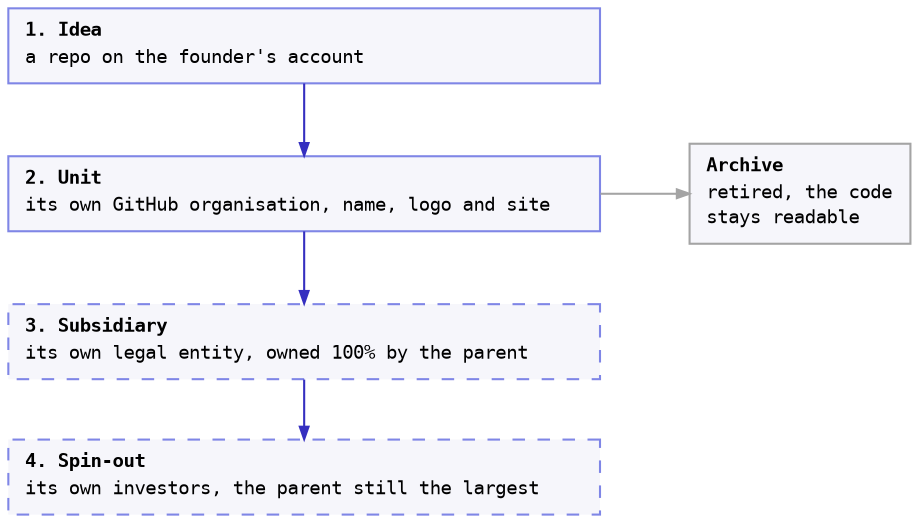

# Structure

> **Working draft.** This is how Planet Renox is organised today and where we want to take it. None of it is a legal filing yet. We update this page as things become official. Last updated November 20, 2026.

## The idea

We like software, and we think a company should be built the way good software is: out of small services that each do one job and can be shipped, scaled or switched off without breaking the rest.

So Planet Renox is a **parent** with small **units** around it. A unit makes one thing, under its own name and logo, and would keep working if every other unit vanished.

Putting the units under one parent, instead of running them as unrelated companies, adds two things:

- **Deep collaboration.** Units share code, fonts, servers and people freely. They all have the same owner, so one unit helping another costs nobody anything.
- **Choice of money flow.** Money a unit earns can flow up to the parent and be spent in another unit. The parent decides where it does the most good.


*One planet, many moons, each a world of its own. Jupiter and its four largest moons, Voyager 1, 1979. NASA/JPL, public domain.*

## Who is who

Today a unit is a GitHub organisation. Planet Renox is in the middle, with its units around it.

```dot
graph "Planet Renox and its units" {
  layout=twopi; root=parent; ranksep=2.6; bgcolor=transparent
  node [shape=none fontname=Courier fontsize=9 fixedsize=true width=1.3 height=0.9 imagepos=tc labelloc=b target="_blank"]
  edge [color="#7f86e6" style=dotted penwidth=1.6]

  parent [label="" image="/orgs/PlanetRenox.svg" imagescale=true width=1.6 height=1.6 URL="https://github.com/PlanetRenox"]

  "sune-org" [image="/orgs/sune-org.webp" URL="https://github.com/sune-org"]
  "lynchmarkHQ" [image="/orgs/lynchmarkHQ.webp" URL="https://github.com/lynchmarkHQ"]
  "direct-img" [image="/orgs/direct-img.webp" URL="https://github.com/direct-img"]
  "ApopheniaNews" [image="/orgs/ApopheniaNews.webp" URL="https://github.com/ApopheniaNews"]
  "ApopheniaLoop" [image="/orgs/ApopheniaLoop.webp" URL="https://github.com/ApopheniaLoop"]
  "inzerosight" [image="/orgs/inzerosight.webp" URL="https://github.com/inzerosight"]
  "GetOpenScript" [image="/orgs/GetOpenScript.webp" URL="https://github.com/GetOpenScript"]
  "EverythingPublic" [image="/orgs/EverythingPublic.webp" URL="https://github.com/EverythingPublic"]
  "hi-language" [image="/orgs/hi-language.webp" URL="https://github.com/hi-language"]
  "OctopusSuite" [image="/orgs/OctopusSuite.webp" URL="https://github.com/OctopusSuite"]
  "microcron" [image="/orgs/microcron.webp" URL="https://github.com/microcron"]
  "archive-yard" [image="/orgs/archive-yard.webp" URL="https://github.com/archive-yard"]
  "4ev-link" [image="/orgs/4ev-link.webp" URL="https://github.com/4ev-link"]
  "multipleof4" [image="/orgs/multipleof4.webp" URL="https://github.com/multipleof4"]

  parent -- { "sune-org" "lynchmarkHQ" "direct-img" "ApopheniaNews" "ApopheniaLoop" "inzerosight" "GetOpenScript" "EverythingPublic" "hi-language" "OctopusSuite" "microcron" }
  // retired units and the founder's account
  parent -- { "archive-yard" "4ev-link" "multipleof4" } [color="#a4a4a4"]
}
```

| | | |
|---|---|---|
|  | [PlanetRenox](https://github.com/PlanetRenox) | the parent: it holds the name, the domain, the typefaces and the clock |
|  | [sune-org](https://github.com/sune-org) | Sune, one chat app for every AI model |
|  | [lynchmarkHQ](https://github.com/lynchmarkHQ) | Lynchmark, a benchmark for language models |
|  | [direct-img](https://github.com/direct-img) | an image for any words, straight from a URL |
|  | [ApopheniaNews](https://github.com/ApopheniaNews) | the news outlet for pattern seekers |
|  | [ApopheniaLoop](https://github.com/ApopheniaLoop) | a video channel on YouTube |
|  | [inzerosight](https://github.com/inzerosight) | a browser extension that hides text in plain sight |
|  | [GetOpenScript](https://github.com/GetOpenScript) | OpenScript, user scripts for Chrome |
|  | [EverythingPublic](https://github.com/EverythingPublic) | public utilities for the web |
|  | [hi-language](https://github.com/hi-language) | Hi, a language in the making |
|  | [OctopusSuite](https://github.com/OctopusSuite) | parts for building interfaces |
|  | [microcron](https://github.com/microcron) | small jobs that run on a schedule |
|  | [4ev-link](https://github.com/4ev-link) | short links that never expire, now retired |
|  | [archive-yard](https://github.com/archive-yard) | where finished experiments rest |
|  | [multipleof4](https://github.com/multipleof4) | the founder's account, where things start before they earn an organisation of their own |

## Working together

Units are separate, not sealed off. Every arrow is something one unit made that another one uses today.

```dot
digraph "What units share" {
  rankdir=LR; bgcolor=transparent; nodesep=0.13; ranksep=2.3
  fontname=Courier; fontsize=9; labeljust=l; color="#a4a4a4"; style=dotted
  node [shape=box fontname=Courier fontsize=9 style=filled fillcolor="#f6f6fb" color="#7f86e6" margin="0.1,0.05" width=2.1 height=0.32]
  edge [arrowsize=0.6]

  subgraph cluster_parent { label=<<TABLE BORDER="0" CELLSPACING="0" CELLPADDING="2"><TR><TD FIXEDSIZE="TRUE" WIDTH="22" HEIGHT="22"></TD><TD><B>PlanetRenox</B> makes</TD></TR></TABLE>>
    web [label="planetrenox.com subdomains"]
    fonts [label="typefaces"]
    news [label="newsletter backend"]
    count [label="visit counter"]
  }
  subgraph cluster_sune { label=<<TABLE BORDER="0" CELLSPACING="0" CELLPADDING="2"><TR><TD FIXEDSIZE="TRUE" WIDTH="22" HEIGHT="22"></TD><TD><B>sune-org</B> makes</TD></TR></TABLE>>
    latex [label="markdown-it-latex-plus"]
  }
  subgraph cluster_direct { label=<<TABLE BORDER="0" CELLSPACING="0" CELLPADDING="2"><TR><TD FIXEDSIZE="TRUE" WIDTH="22" HEIGHT="22"></TD><TD><B>direct-img</B> makes</TD></TR></TABLE>>
    img [label="pictures and animations"]
  }

  subgraph cluster_users { label="and these use it"
    node [shape=none style="" margin=0 width=0 height=0]
    sune [label=<<TABLE BORDER="0" CELLSPACING="0" CELLPADDING="3"><TR><TD FIXEDSIZE="TRUE" WIDTH="30" HEIGHT="30"></TD><TD ALIGN="LEFT" BALIGN="LEFT"><B>sune-org</B><BR/>Sune chat app</TD></TR></TABLE>>]
    lynch [label=<<TABLE BORDER="0" CELLSPACING="0" CELLPADDING="3"><TR><TD FIXEDSIZE="TRUE" WIDTH="30" HEIGHT="30"></TD><TD ALIGN="LEFT" BALIGN="LEFT"><B>lynchmarkHQ</B><BR/>LLM benchmark</TD></TR></TABLE>>]
    direct [label=<<TABLE BORDER="0" CELLSPACING="0" CELLPADDING="3"><TR><TD FIXEDSIZE="TRUE" WIDTH="30" HEIGHT="30"></TD><TD ALIGN="LEFT" BALIGN="LEFT"><B>direct-img</B><BR/>images by URL</TD></TR></TABLE>>]
    apo [label=<<TABLE BORDER="0" CELLSPACING="0" CELLPADDING="3"><TR><TD FIXEDSIZE="TRUE" WIDTH="30" HEIGHT="30"></TD><TD ALIGN="LEFT" BALIGN="LEFT"><B>ApopheniaNews</B><BR/>news outlet</TD></TR></TABLE>>]
    site [label=<<TABLE BORDER="0" CELLSPACING="0" CELLPADDING="3"><TR><TD FIXEDSIZE="TRUE" WIDTH="30" HEIGHT="30"></TD><TD ALIGN="LEFT" BALIGN="LEFT"><B>PlanetRenox</B><BR/>this site</TD></TR></TABLE>>]
    m4 [label=<<TABLE BORDER="0" CELLSPACING="0" CELLPADDING="3"><TR><TD FIXEDSIZE="TRUE" WIDTH="30" HEIGHT="30"></TD><TD ALIGN="LEFT" BALIGN="LEFT"><B>multipleof4</B><BR/>founder's account</TD></TR></TABLE>>]
  }

  edge [color="#352fc0"]
  web -> { sune lynch }
  fonts -> { lynch direct apo m4 }
  news -> { apo lynch direct }
  count -> lynch
  edge [color="#000000"]
  latex -> { apo site }
  edge [color="#7f86e6"]
  img -> { apo m4 }
}
```

## Money

This part is the plan, not yet the practice. Dashed lines are things that may never be needed.

```dot
digraph "How money moves" {
  bgcolor=transparent; ranksep=0.7; nodesep=0.35
  node [shape=box fontname=Courier fontsize=9 style=filled fillcolor="#f6f6fb" color="#7f86e6" margin="0.12,0.08"]
  edge [fontname=Courier fontsize=8 arrowsize=0.6 color="#352fc0" fontcolor="#352fc0"]

  investors [label="Outside investors" style="dashed,filled" fillcolor=white]
  backers [label="Backers of\nunit D only" style="dashed,filled" fillcolor=white]
  parent [shape=none style="" margin=0 label=<<TABLE BORDER="1" COLOR="#352fc0" CELLBORDER="0" CELLSPACING="0" CELLPADDING="6" BGCOLOR="#f6f6fb"><TR>
    <TD FIXEDSIZE="TRUE" WIDTH="40" HEIGHT="40"></TD>
    <TD ALIGN="LEFT" BALIGN="LEFT"><B>Planet Renox, the parent</B><BR/>holds the name, the domains,<BR/>the rights and the reserves</TD>
  </TR></TABLE>>]
  a [label="Unit A\nearns a profit"]
  b [label="Unit B\nstill growing"]
  c [label="Unit C\nbrand new"]
  d [label="Unit D\nspun out" style="dashed,filled"]
  customers [label="Customers" fillcolor=white]

  { rank=same; parent; backers }
  { rank=same; a; b; c; d }

  investors -> parent [style=dashed label=" buy a share of the parent,\l and so of every unit\l"]
  parent -> a [dir=back label=" profit\l goes up\l"]
  parent -> b [label=" capital\l comes down\l"]
  parent -> c
  parent -> d [style=dashed label=" keeps the\l largest share\l"]
  backers -> d [style=dashed]
  a -> b [dir=both style=dotted color="#7f86e6" fontcolor="#666666" label="shared work"]
  b -> c [dir=both style=dotted color="#7f86e6"]
  a -> customers [dir=back label=" revenue"]
  b -> customers [dir=back]
}
```

1. **Outside money comes in at the top.** If Planet Renox ever takes investment, the investors buy a share of the parent, and so of everything under it. No unit has outside owners of its own.
2. **Profit goes up, capital comes down.** A unit that earns more than it needs passes the rest up to the parent, and the parent funds whichever unit can use it best. Money does not move sideways from one unit to another.
3. **Shared things are held once.** The name, the domains, the rights and the reserves sit with the parent.
4. **There is a way out.** A unit that needs backers of its own can be spun out and take them directly, while Planet Renox stays its largest owner. From then on it deals with the other units at arm's length, like any outside company.

Why not simply run several companies? Because when companies share a founder but not their owners, every engineer, server or dollar that one lends another helps one set of owners at the cost of the other, and has to be argued over. The only cure later is a merger. One parent that owns every unit outright never has the argument.

## The life of a unit



Almost everything is at stage 2 today. Stage 3 comes when a unit has income or risk worth putting in a company of its own, and not before.
