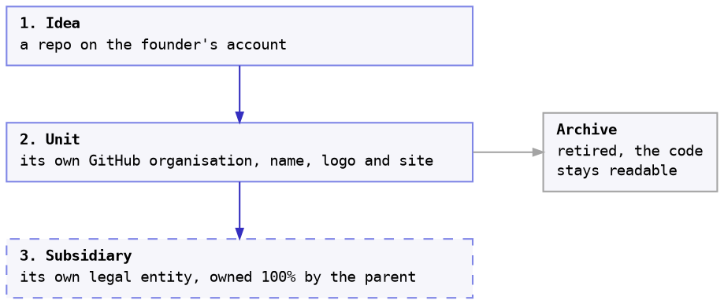

# Structure

> **Working draft.** This is how Planet Renox is organised today and where we want to take it. None of it is a legal filing yet. We update this page as things become official. Last updated November 20, 2026.

## The idea

We like software, and we think a company should be built the way good software is: out of small services that each do one job and can be shipped, scaled or switched off without breaking the rest.

So Planet Renox is a **parent** with small **units** around it. A unit makes one thing, under its own name and logo, and would keep working if every other unit vanished.

Putting the units under one parent, instead of running them as unrelated companies, adds two things:

- **Deep collaboration.** Units share code, fonts, servers and people freely. They all have the same owner, so one unit helping another costs nobody anything.
- **Choice of money flow.** Money a unit earns can flow up to the parent and be spent in another unit. The parent decides where it does the most good.

## Who is who

Today a unit is a GitHub organisation. Planet Renox is in the middle, with its units around it.

```dot
graph "Planet Renox and its units" {
  layout=twopi; root=parent; ranksep=2.6; bgcolor=transparent
  node [shape=none fontname=Courier fontsize=9 fixedsize=true width=1.3 height=0.9 imagepos=tc labelloc=b target="_blank"]
  edge [color="#7f86e6" style=dotted penwidth=1.6]

  parent [label="" image="/orgs/PlanetRenox.svg" imagescale=true width=1.6 height=1.6 URL="https://github.com/PlanetRenox"]

  "sune-org" [image="/orgs/sune-org.webp" URL="https://github.com/sune-org"]
  "lynchmarkHQ" [image="/orgs/lynchmarkHQ.webp" URL="https://github.com/lynchmarkHQ"]
  "direct-img" [image="/orgs/direct-img.webp" URL="https://github.com/direct-img"]
  "ApopheniaNews" [image="/orgs/ApopheniaNews.webp" URL="https://github.com/ApopheniaNews"]
  "ApopheniaLoop" [image="/orgs/ApopheniaLoop.webp" URL="https://github.com/ApopheniaLoop"]
  "inzerosight" [image="/orgs/inzerosight.webp" URL="https://github.com/inzerosight"]
  "GetOpenScript" [image="/orgs/GetOpenScript.webp" URL="https://github.com/GetOpenScript"]
  "EverythingPublic" [image="/orgs/EverythingPublic.webp" URL="https://github.com/EverythingPublic"]
  "hi-language" [image="/orgs/hi-language.webp" URL="https://github.com/hi-language"]
  "OctopusSuite" [image="/orgs/OctopusSuite.webp" URL="https://github.com/OctopusSuite"]
  "microcron" [image="/orgs/microcron.webp" URL="https://github.com/microcron"]
  "archive-yard" [image="/orgs/archive-yard.webp" URL="https://github.com/archive-yard"]
  "4ev-link" [image="/orgs/4ev-link.webp" URL="https://github.com/4ev-link"]
  "multipleof4" [image="/orgs/multipleof4.webp" URL="https://github.com/multipleof4"]

  parent -- { "sune-org" "lynchmarkHQ" "direct-img" "ApopheniaNews" "ApopheniaLoop" "inzerosight" "GetOpenScript" "EverythingPublic" "hi-language" "OctopusSuite" "microcron" }
  // retired units and the founder's account
  parent -- { "archive-yard" "4ev-link" "multipleof4" } [color="#a4a4a4"]
}
```

## Money

Money a unit earns flows up to the parent, and the parent sends it down to whichever unit can use it best. If Planet Renox ever takes outside investment, it comes in at the parent, so no unit has outside owners of its own.

## The life of a unit



Almost everything is at stage 2 today. Stage 3 comes when a unit has income or risk worth putting in a company of its own, and not before.
